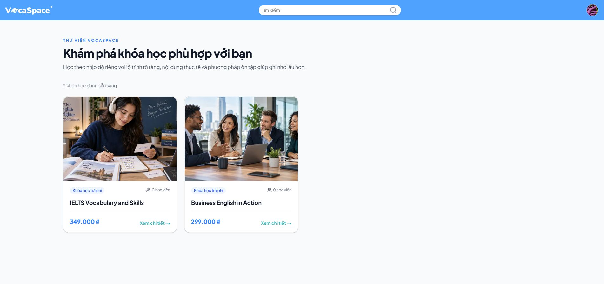
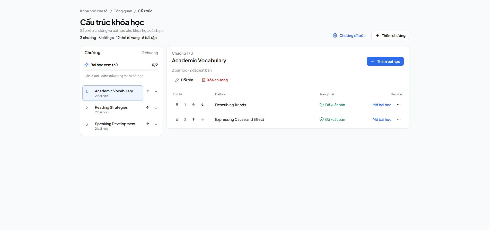

# VocaSpace

**VocaSpace is a language-learning website for studying vocabulary and practicing through structured courses, flashcards, exercises, and spaced repetition.**

Learners can explore courses, preview lessons, enroll, and follow their progress. Teachers build and maintain course content, while administrators manage users and course publication.

[Visit VocaSpace](https://vocaspace.com/) · [Browse courses](https://vocaspace.com/courses) · [Development guide](CONTRIBUTING.md)



## Learning with VocaSpace

- **Explore courses:** browse the public catalog, read course details, and try the lessons available for preview.
- **Learn in context:** work through courses organized into chapters and topics.
- **Practice vocabulary:** study flashcards and record recall ratings with FSRS-based spaced-repetition scheduling.
- **Check understanding:** answer exercises and memory checks, with progress recorded for each topic.
- **Continue learning:** return to enrolled courses and see lesson completion and the remaining course structure.
- **Manage an account:** sign in with email or Google, update a profile, and recover access through email.
- **Enroll in courses:** join available courses, with PayOS checkout for paid enrollment.

## Course authoring and administration

Teachers can create courses, organize chapters and topics, author flashcards and exercises, and collaborate on course content. Readiness checks and review workflows support submission and publication.

Administrators have dedicated screens for user management and course review. Authorization and content visibility are enforced by application checks and Supabase database policies.



## Technology

| Area | Technology |
| --- | --- |
| Web application | Next.js, React, TypeScript |
| Interface | Tailwind CSS, Radix UI |
| Data and authentication | Supabase Auth, PostgreSQL, Storage |
| Vocabulary scheduling | FSRS through `ts-fsrs` |
| Payments | PayOS |
| Verification | Vitest, Testing Library, Playwright |
| Hosting | Vercel |

## Local development

Repository access is required. Install a current Node.js LTS release, npm, Git, and Docker, then start Docker before running:

```bash
git clone https://github.com/khangnhoang/VocaSpace.git
cd VocaSpace
npm install
npm run dev
```

`npm run dev` starts the local Supabase project, reads its runtime credentials, and launches Next.js. It rejects a non-local Supabase endpoint. The development database uses the repository's canonical `4532x` ports; automated E2E uses a separate disposable environment.

Useful local database commands:

```bash
npm run supabase:dev:start
npm run supabase:dev:status
npm run supabase:dev:stop
```

See [the local development guide](docs/sop/local-development.md) for ports, database persistence, and the separation between development and E2E environments. Production integrations, including Google OAuth and PayOS, require their own configuration and credentials.

## Verification

Choose checks appropriate to the change:

```bash
npm run lint
npm run test:ci
npm run build
npm run docs:check
```

Database integration and browser checks require their local services and fixtures:

```bash
npm run test:integration
npm run test:e2e:smoke
```

These commands describe the available checks; they are not a claim that every check currently passes. Production release requirements are documented in [the release gate](docs/sop/production-release-gate.md).

## Repository map

| Path | Purpose |
| --- | --- |
| [`app/`](app) | learner, teacher, admin, Auth, and payment routes and Server Actions |
| [`components/`](components) | shared interface components |
| [`lib/`](lib), [`services/`](services) | domain logic, validation, and external integrations |
| [`supabase/`](supabase) | migrations, database policies, seed data, and local configuration |
| [`__tests__/`](__tests__), [`e2e/`](e2e) | automated product verification |
| [`docs/`](docs/README.md), [`.agents/`](.agents) | product plans, operating procedures, and agent development instructions |

## How agent engineering supports development

Agent engineering supports the work of maintaining VocaSpace. [`AGENTS.md`](AGENTS.md) and versioned skills in [`.agents/`](.agents) guide discovery, implementation, database safety, testing, and review. [Lifecycle rules](docs/agent-loops.md) keep implementation, verification, commits, and production actions tied to explicit scope and authority.

This gives developers and coding agents shared instructions for making focused changes and recording what was actually verified. Automated checks support review, while the repository owner retains control of acceptance and production actions. The [ASM-PR6 case study](docs/case-studies/asm-pr6-agent-skill-evaluation.md) documents one evaluation of these workflows.

## Repository access and licensing

The repository is maintained privately and is not offered under a project-wide open-source license. Earlier MIT-licensed versions retain their applicable license terms.
